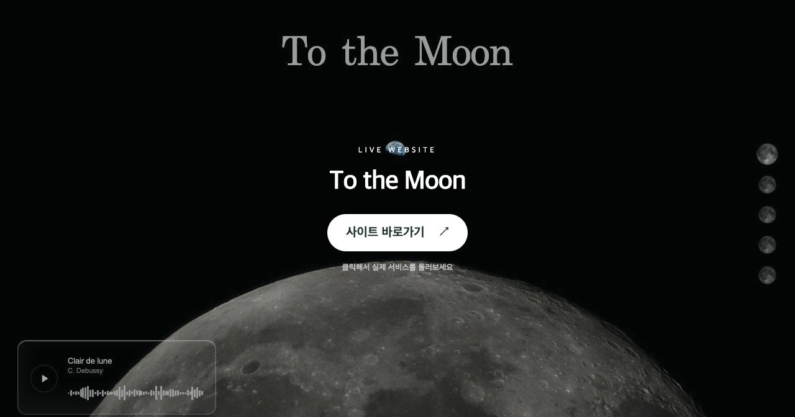
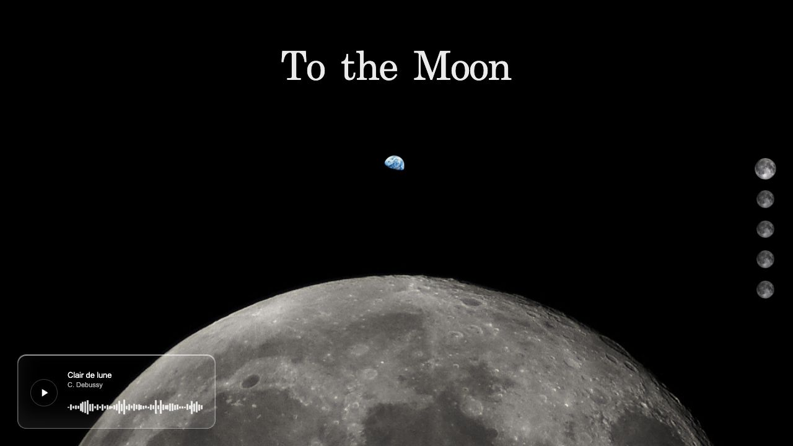
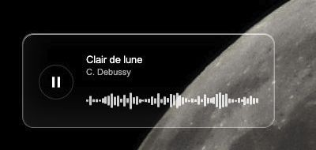
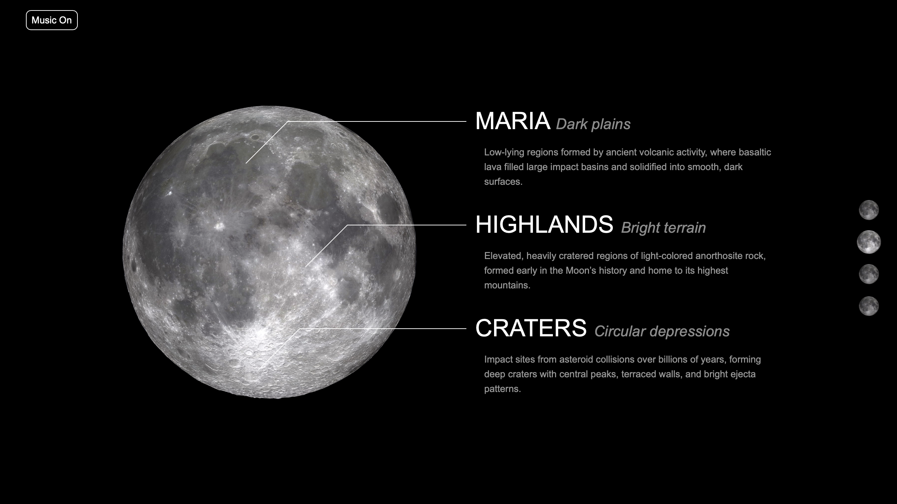
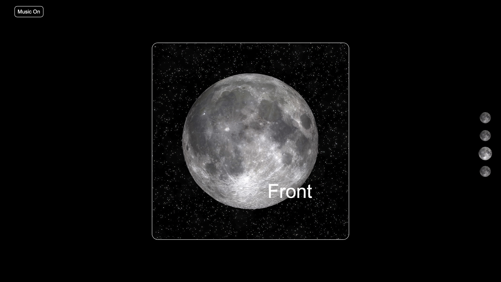
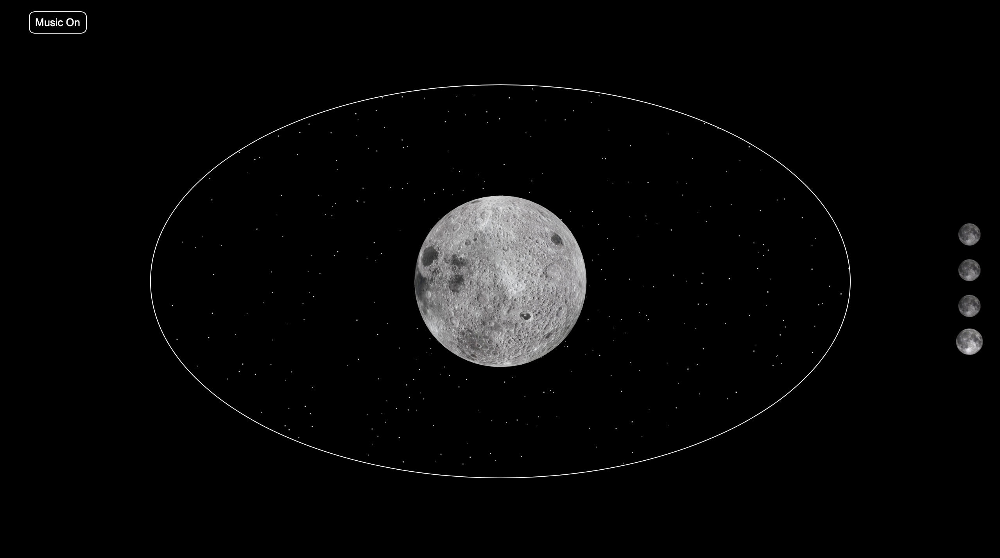
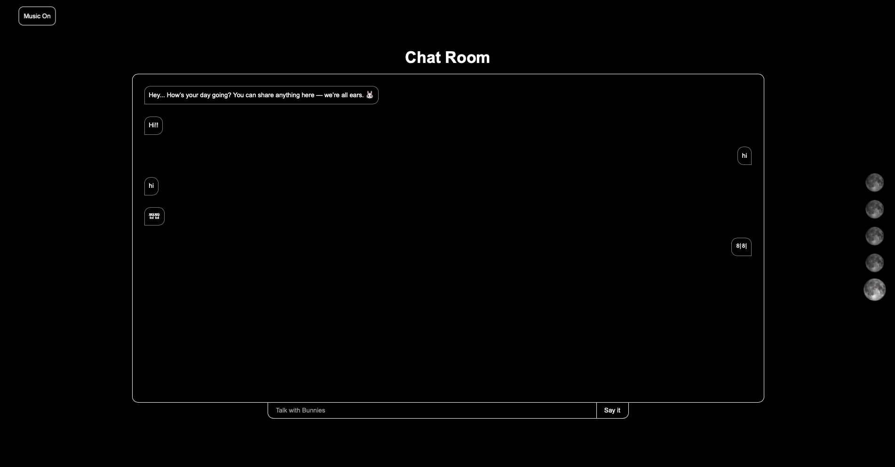

# 🌙 To the Moon

[](https://to-the-moon-ashen.vercel.app)

달에 관한 정보를 시각적으로 확인할 수 있는 웹사이트입니다.
Canvas를 활용한 3D 모델링과 다양한 CSS 애니메이션을 적용하여 생동감 있는 사용자 경험을 제공합니다.

## 📆 프로젝트 기간
- **초기 개발:** 2020.6 - 2020.7 (React.js 기반)
- **업그레이드:** 2025.2 - 2025.2 (Next.js로 변경)
- **UI 개선:** 2026.11 (글라스모피즘 뮤직 플레이어)

## 👨‍💻 역할
- 1인 개발 (Full-Stack Development)

## 🛠️ 사용 기술
- **Frontend**: React.js → Next.js 15.5.28, React 19, TypeScript
- **실시간 채팅**: Firebase Firestore
- **이전 버전**: Node.js, Express.js, MongoDB
- **3D 모델링**: Canvas API, Three.js
- **CSS 애니메이션**: keyframes, transform 등 활용
- **UI 효과**: CSS Modules, `@dpawlikowski/liquid-glass`

## 🚀 섹션별 설명
- **인트로**: CSS transform과 transition을 이용해 달이 떠오르는 장면을 구성했습니다.


- **글라스모피즘 뮤직 플레이어**: 투명한 배경과 유리 테두리로 기존 뮤직 버튼을 개선했습니다. 드뷔시의 「달빛」을 재생하는 동안 파형이 움직입니다.



- **달 지형 정보**: SF영화의 우주선 계기판에서 영감을 받아 물체의 정보를 표시하는 애니메이션을 설정하였습니다.


- **CSS 카드 애니메이션**: Mouse hover 했을 시에 카드가 뒤집히며 달의 뒷면을 볼 수 있도록 하였습니다. z-index를 통해 카드임에도 3D로 보이도록 하였습니다. 달의 뒷면을 볼 때에는 귀여운 지구가 작게 보이도록 하여 실제로 달의 뒷면에서 바라본 풍경을 고증하였습니다. (궁금하도록 이미지 첨부는 하지 않았으니 위의 링크를 통해 직접 확인해보세요)


- **3D 모델**: Three.js를 통해 Nasa에서 받아온 달의 3D 모델을 사용자가 직접 움직이며 확인할 수 있습니다. 시간에 따라 조금씩 움직이도록 하여 생동감을 더했습니다.


- **실시간 채팅**: React 버전의 WebSocket·Express·MongoDB 구성을 Firebase Firestore 기반으로 옮겼습니다. Next.js의 클라이언트 컴포넌트에서 메시지를 구독해 서버리스 배포 환경에서도 새 메시지를 확인할 수 있습니다.


## 📌 설치 및 실행 방법
```sh
# 1. 프로젝트 클론
git clone https://github.com/moonjiuk/to-the-moon.git
cd to-the-moon

# 2. 패키지 설치
npm ci

# 3. 개발 서버 실행
npm run dev
```


운영 빌드: `npm run build` · 실행: `npm start`
